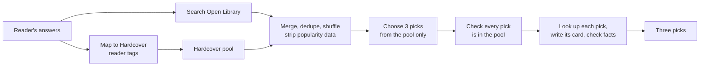

# Squirmly

**An AI book discovery app that finds the next book you'll love, and makes finding, collecting and ranking books feel like play.**

Squirmly (working name) asks a few playful, themed questions, then reveals three books that are intriguing and relevant to you, not the famous picks every "if you liked X" list repeats. Every pick is a real book from a real catalog, unwrapped like a collectible card.

Built as a product and AI-engineering project: grounding, evaluation, swappable models, and honest handling of an LLM's pull toward mainstream answers.

## The vision
| Tab | What it does | When |
|---|---|---|
| **Discover** | An adaptive, themed question flow, then a theatrical reveal of three picks as 3D books with rarity tiers | v0 |
| **Collection** | Finish a book → earn its card → optionally rank it. A shelf for tracking; pairwise rankings instead of star ratings | After v0 |
| **You** | Your taste profile, reading insights and a yearly recap | After v0 |

Five visual themes (Café Bookshop, Mystery, Fantasy, Superhero, Sci-fi) give every screen its own world. Full vision and backlog: [roadmap](./docs/product/roadmap-and-backlog.md).

## Status
- **Engine:** complete and deployed privately on Vercel. Baseline: 11/11 eval cases delivered, 33/33 picks grounded in retrieved catalogs. About 25 seconds and $0.08 per recommendation.
- **v0, in progress:** a polished preview of the full Discover experience, shared on a private link. Soft target: end of 2026. [What's in v0](./docs/product/v0-scope.md).
- **Now:** restructuring the repo for v0 ([repo guide](./docs/engineering/repo-guide.md)), alongside a design pass on illustration and the reveal.

## The problems worth solving
Calling an LLM is easy. These aren't:
- **How do you stop a recommender defaulting to famous, obvious books?**
- **How do you make sure every pick is a real book, described accurately?**
- **How do you know it's working, rather than eyeballing outputs?**
- **How do you learn someone's taste without turning the app into a survey?**
- **How do you keep it current when better models ship every month?**

## How the engine works

1. **Retrieve real candidates** from two catalogs: Open Library for breadth, Hardcover for reader-applied mood and genre tags.
2. **Neutralize popularity.** Pools are merged, shuffled and stripped of ranking data, so neither catalog's bestseller ordering reaches the model.
3. **Pick only from the pool.** Code checks every pick against the candidates the model was shown; a miss retries rather than ever returning an invented or remembered book.
4. **Verify what readers see.** Each pick is looked up in its catalog, and flagged descriptions are checked against catalog facts.

More detail: [architecture](./docs/engineering/architecture.md).

## How it's built
- **Eval-driven.** A six-part rubric (relevance, non-obviousness, range, correctness, traceability, variety) scored against outside sources like Goodreads and award records, not the model's own judgment. [Eval set](./docs/quality/eval-set.md).
- **Evidence before architecture.** Most design calls were settled by a small test first; several confident hypotheses were proven wrong.
- **Rules enforced in code,** not left to prompt instructions: grounding, search limits, bias controls.
- **Everything swappable.** Models, book sources, storage, themes and the question flow sit behind contracts, so a better option can be swapped in by changing a setting. [Contracts and adapters](./docs/engineering/contracts-and-adapters.md).
- **A question flow, not a form.** An adaptive taste profile built on the appeal factors librarians use, with a growing bank of playful question formats. [Question flow v2](./docs/product/question-flow/v2-design.md).

Every decision, including reversals and rejected paths: [`docs/decisions.md`](./docs/decisions.md).

## Stack
- **Next.js** (TypeScript, App Router), hosted on **Vercel**
- **Anthropic API:** Claude Sonnet for choosing picks, tag mapping and card writing; Claude Haiku for checks
- **Open Library:** breadth catalog (subject lists and search)
- **Hardcover** (GraphQL): reader-applied taste tags

## Getting started
```bash
npm install
npm run dev
```

Add to `.env.local` (never committed):
- `ANTHROPIC_API_KEY`: required
- `HARDCOVER_API_TOKEN`: optional; without it, the engine runs on Open Library alone

The screens aren't in the app yet (they're being built for v0). Call the engine directly:

```bash
curl -X POST localhost:3000/api/recommend \
  -H "Content-Type: application/json" \
  -d '{"tasteDescription": "Quiet, character-driven literary fiction with a strong sense of place."}'
```

## Docs
Start with the [docs map](./docs/README.md). Key docs:
- [v0 scope](./docs/product/v0-scope.md) · [roadmap and backlog](./docs/product/roadmap-and-backlog.md)
- [Design system](./docs/design/design-system.md) · [art direction](./docs/design/art-direction.md)
- [Architecture](./docs/engineering/architecture.md) · [contracts and adapters](./docs/engineering/contracts-and-adapters.md) · [repo guide](./docs/engineering/repo-guide.md)
- [Decisions](./docs/decisions.md) · [progress log](./docs/progress-log.md)

## Rights
All rights reserved. The code is public to read; the themes, artwork and brand are not licensed for reuse.
