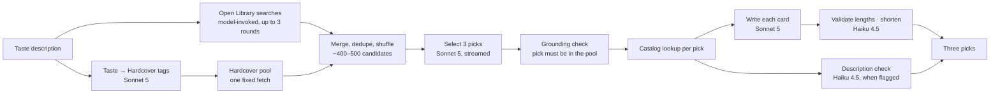
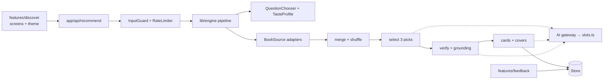

# Architecture

> **Status:** Living · Describes the engine as it runs today and where it's heading. Last updated Nov 1, 2026.

## Today: one engine behind one API route
`app/api/recommend/route.ts` takes a taste description and returns three picks (the [spec §4b](../product/spec.md) contract). About 25 seconds and $0.08 per request.

Rules enforced in code (see [CLAUDE.md](../../CLAUDE.md)): picks come only from the retrieved pools; the model sees only title, author and subjects, shuffled; tag selection never sees tag counts; length overflow never fails a request.

## Heading: features on shared infrastructure
The app is organized by feature, on top of shared infrastructure that every feature uses ([repo guide](./repo-guide.md)). Every swappable part sits behind a contract ([contracts and adapters](./contracts-and-adapters.md)).

Every box talks to the next through a contract. Dotted lines are AI jobs, each choosing its model in one settings file.

## Hosting
Vercel (Hobby plan), private: Deployment Protection is on for all deployments. Production keys are Vercel secrets in a separate, spend-capped API workspace. The recommend route allows up to 300 seconds.
